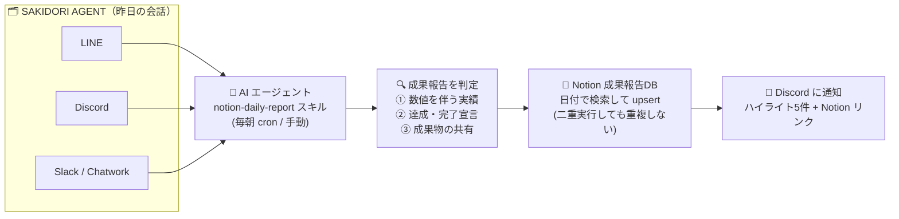
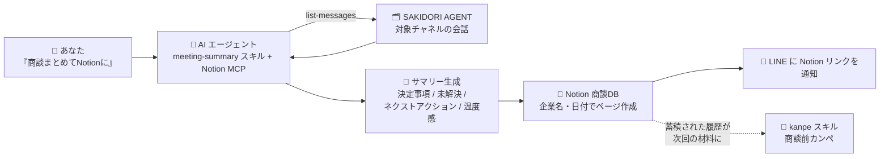
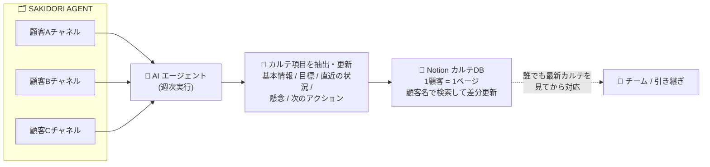
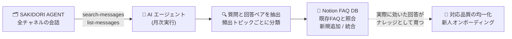
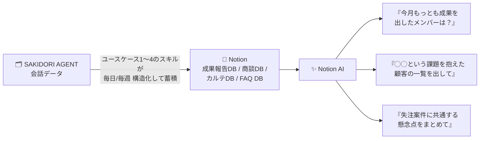

# Notion MCP / Notion AI 連携ユースケース集（図解）

SAKIDORI AGENT MCP と [Notion 公式 MCP](https://developers.notion.com/docs/mcp) を同じ AI エージェントに接続すると、**会話データの分析結果を Notion に構造化して蓄積する**ワークフローが組めます。LINE への単発配信と違い、Notion に貯めることで後から検索・集計・Notion AI での活用が可能になります。

各ユースケースを「**解決したい課題 → 解決フロー → 解決プロンプト**」のセットで図解します。プロンプトはそのままコピペで使えます。

- [1. 成果報告デイリーレポート](#1-成果報告デイリーレポート)
- [2. 商談議事録の Notion 蓄積](#2-商談議事録の-notion-蓄積)
- [3. 顧客カルテの自動生成](#3-顧客カルテの自動生成)
- [4. FAQ・ナレッジベースの自動構築](#4-faqナレッジベースの自動構築)
- [5. Notion AI との組み合わせ](#5-notion-ai-との組み合わせ蓄積後の活用)

**前提**: SAKIDORI AGENT MCP と Notion MCP を接続済みであること（[README](../README.md) / [クイックスタート](notion-daily-report/) 参照）。

---

## 1. 成果報告デイリーレポート

> 実装済みスキル: [`skills/notion-daily-report`](../skills/notion-daily-report/) ／ コピペ導入: [クイックスタート](notion-daily-report/)

### 解決したい課題

- メンバー・受講生の成果報告が複数チャネルに散在し、拾い漏れる
- 称賛やフォローが遅れてモチベーションの機会を逃す
- 月次の成果集計を手作業でやっている

### 解決フロー



### 解決プロンプト

初回（セットアップ込み・対話）:

```
成果報告レポート作って
```

日付・条件指定:

```
7/22の成果報告レポートを作って。Discordには送らずNotionだけ更新して
```

定期実行（cron / GitHub Actions に設定するプロンプト。[run.sh](notion-daily-report/run.sh) に設定済み）:

```
notion-daily-report スキルを定期実行モードで実行して。昨日（JST）の成果報告レポートを
Notion に upsert し、Discord チャネル ID <チャネルID> に通知まで完了させること。確認は不要。
失敗した場合はエラー内容を同じチャネルに通知すること。
```

---

## 2. 商談議事録の Notion 蓄積

### 解決したい課題

- 商談サマリーを LINE で受け取っても流れてしまい、過去の経緯を辿れない
- 企業ごとの商談履歴が 1 か所にまとまっていない
- 次回商談の準備（カンペ）の材料が散らばっている

### 解決フロー



### 解決プロンプト

```
ABC商事の直近1週間の商談サマリーを作って、Notionの「商談議事録」データベースに
「日付・企業名・決定事項・未解決事項・ネクストアクション」のページとして保存して。
保存できたらページのリンクをLINEで私に送って
```

毎週の運用:

```
今週商談があった全チャネルについて、チャネルごとに商談サマリーを作って
Notionの「商談議事録」データベースに追加して。既に同じ週・同じ企業のページがあれば更新して
```

---

## 3. 顧客カルテの自動生成

### 解決したい課題

- 顧客/受講生ごとの状況（背景・目標・進捗・懸念）が担当者の頭の中にしかない
- 担当交代・チーム対応のたびに過去ログを全部読み返している
- 「この顧客、前に何を約束したっけ？」が即答できない

### 解決フロー



### 解決プロンプト

初回（カルテの新規作成）:

```
ABC商事チャネルの全会話履歴を分析して、Notionの「顧客カルテ」データベースに
カルテページを作って。項目は「基本情報 / 目標 / 直近の状況 / 懸念 / 次のアクション」。
最後に「更新日と根拠にした会話期間」を記録して
```

運用（差分更新）:

```
「顧客カルテ」データベースの全ページについて、前回更新日以降の会話をSAKIDORI AGENTから
取得してカルテを更新して。変化があった顧客だけ、何が変わったかを箇条書きで報告して
```

---

## 4. FAQ・ナレッジベースの自動構築

### 解決したい課題

- 同じ質問への回答を毎回ゼロから書いている
- ベテランの「良い回答」がチャネルに埋もれて再利用されない
- 新人が過去のやりとりを検索できない

### 解決フロー



### 解決プロンプト

```
直近1ヶ月の全チャネルの会話から「顧客からの質問とそれに対する回答」のペアを抽出して、
頻出トピックごとに分類して。Notionの「FAQ」データベースに「質問 / 回答 / トピック / 出典チャネル」
の形式で追加して。既に似た質問がある場合は追加せず、回答をより良い方に更新して
```

---

## 5. Notion AI との組み合わせ（蓄積後の活用）

### 解決したい課題

- データを蓄積しても「見に行く」習慣がなければ使われない
- 「今月一番成果を出したのは誰？」のような横断の問いに即答できない
- 分析のたびに AI エージェントで生ログを読み直すのはコストが高い

### 解決フロー

役割分担: **SAKIDORI AGENT MCP = 会話データを Notion に構造化して流し込む役**、**Notion AI = 蓄積後の横断検索・要約・Q&A 役**。



### 解決プロンプト

Notion AI 側に聞く（Notion 上で）:

```
成果報告デイリーレポートのデータベースから、今月もっとも成果報告が多かったメンバー
トップ3と、それぞれの代表的な成果を教えて
```

```
顧客カルテのデータベースを横断して、「価格」に懸念を持っている顧客の一覧と、
それぞれの状況を表にして
```

設計のコツ: **Notion AI で聞きたい質問から逆算して DB のプロパティを設計**すること。「メンバー別に集計したい」なら報告者をプロパティに、「失注分析したい」ならステータスと懸念をプロパティに切り出しておく。

---

## 定期実行するには

これらのユースケースは定期実行（毎朝・毎週）と組み合わせて真価を発揮します。コピペで使える実行ファイル（cron / GitHub Actions）は [notion-daily-report クイックスタート](notion-daily-report/) を、無人実行の設計原則は [`scheduled-execution.md`](../skills/drm-agent-extension-dev/references/scheduled-execution.md) を参照してください。

自組織向けにカスタマイズしたスキルにしたい場合は [`drm-agent-extension-dev`](../skills/drm-agent-extension-dev/) が課題定義から SKILL.md 作成までガイドします。
