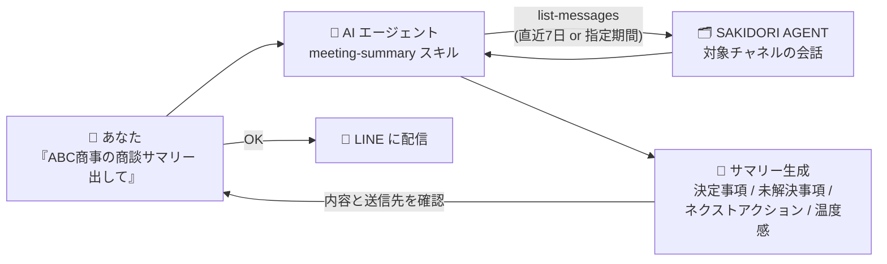
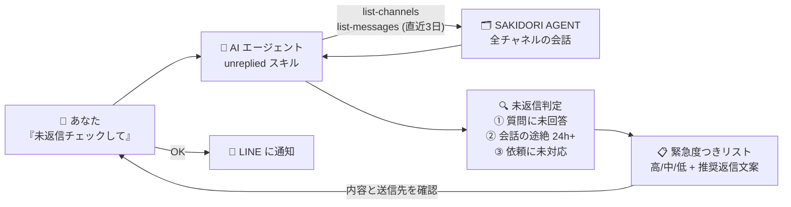
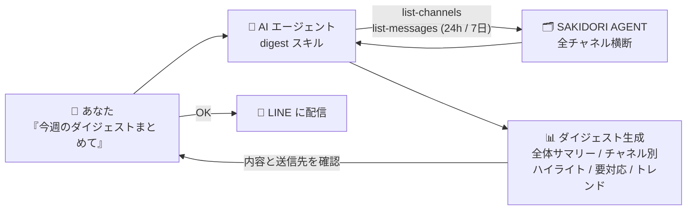

```mermaid
flowchart LR
    U["🙋 あなた<br/>『ABC商事のカンペ作って』"] --> B["🤖 AI エージェント<br/>kanpe スキル"]
    B -- "search-messages<br/>list-messages" --> D["🗂 SAKIDORI AGENT<br/>ABC商事との全やりとり"]
    D --> B
    B --> E["📝 カンペ生成<br/>オープニング / 確認事項 /<br/>ゴール / 想定Q&A / クロージング"]
    E -- "内容と送信先を確認" --> U
    U -- "OK" --> F["📱 LINE に配信<br/>carousel 3〜4枚"]
```

# 図解: 基本スキルのフロー集

各スキルを「**解決したい課題 → 解決フロー → 解決プロンプト**」のセットで図解します。プロンプトはそのままコピペで使えます。

- [kanpe（商談前カンペ）](#kanpe商談前カンペ)
- [meeting-summary（商談サマリー）](#meeting-summary商談サマリー)
- [unreplied（未返信アラート）](#unreplied未返信アラート)
- [digest（日次/週次ダイジェスト）](#digest日次週次ダイジェスト)

---

## kanpe（商談前カンペ）

### 解決したい課題

- 商談前に過去のやりとりを LINE で遡って読み返すのに 30 分かかる
- 前回の宿題・相手の懸念を忘れたまま商談に入ってしまう
- 準備の質が担当者の記憶力に依存している

### 解決フロー



### 解決プロンプト

```
ABC商事のカンペ作って
```

```
明日の田中さんとの商談準備をして。特に前回持ち越しになった件を重点的に
```

```
ABC商事のカンペを作って、営業チームの佐藤さんのLINEに送って
```

---

## meeting-summary（商談サマリー）

### 解決したい課題

- 商談後の議事録作成に毎回 20〜30 分かかっている
- 「次に何をやるか」が曖昧なまま流れて、フォローが遅れる
- チームに商談の温度感が共有されない

### 解決フロー



### 解決プロンプト

```
ABC商事の直近1週間の商談サマリー出して
```

```
田中さんチャネルの今日の打ち合わせ内容をまとめて、ネクストアクションを期限つきで整理して
```

---

## unreplied（未返信アラート）

### 解決したい課題

- チャネルが増えて返信漏れに気づけない（気づいた時には数日経過）
- 「あの件どうなりました？」と催促されてから慌てて対応している
- 機会損失・信頼低下につながっている

### 解決フロー



### 解決プロンプト

```
未返信チェックして
```

```
ABC商事チャネルの返信漏れを1週間分チェックして
```

```
未返信チェックして、緊急度「高」だけ返信文案つきで教えて
```

---

## digest（日次/週次ダイジェスト）

### 解決したい課題

- 全チャネルを毎日見て回る時間がない（把握だけで 1 時間）
- 重要な動き・要対応事項がノイズに埋もれる
- 週次の振り返り資料を手作業で作っている

### 解決フロー



### 解決プロンプト

```
今日のダイジェストまとめて
```

```
週次ダイジェストをDiscordチャネル分だけ作って
```

```
今週のダイジェストをまとめて、先週と比べて活動が減っているチャネルを教えて
```

---

## Notion と組み合わせた発展形

これらのスキルの出力先を LINE から Notion に変えて「蓄積」する発展ユースケースは [notion-usecases.md](notion-usecases.md) を参照してください（同じ 課題 → フロー → プロンプト形式で図解しています）。
